# DOCUSURE System Flowchart

This document presents the complete system flowchart for **DOCUSURE — Intelligent Document Processing, Information Extraction and Verification Using Generative AI**.

---

### Standard Flowchart Symbol Legend

| Symbol Shape | Standard Flowchart Notation | Function in DOCUSURE |
|---|---|---|
| **Oval / Pill (`([ ... ])`)** | **Terminal (Start / End)** | Marks system entry (document upload initiation) and completion (final result output). |
| **Rectangle (`[ ... ]`)** | **Process Execution** | Represents automated computational stages (preprocessing, OCR, classification, extraction, verification, summarization, logging). |
| **Diamond (`{ ... }`)** | **Decision Gate** | Represents conditional branching logic (quality assessment check, human review acceptance/edit). |
| **Solid Arrow (`-->`)** | **Sequential Workflow** | Direction of execution between system components. |

---

### Mermaid Flowchart Source

```mermaid
flowchart TD
    %% Terminal Nodes
    StartNode([START]):::terminalStyle
    EndNode([END]):::terminalStyle

    %% Process Nodes
    UploadDoc[Upload Document]:::processStyle
    InputDoc[PDF / Image Input]:::processStyle
    DocIngest[Document Ingestion]:::processStyle
    PageRender[Page Rendering / Loading]:::processStyle
    ImgPreproc[Image Preprocessing<br/>Deskew / Denoise / Enhance]:::processStyle
    OcrEngine[OCR Extraction]:::processStyle
    SpatialText[Text + Spatial Information]:::processStyle
    DocClassify[Document Type Classification]:::processStyle
    StructExtract[Structured Information Extraction]:::processStyle
    TableFieldParse[Table / Field Parsing]:::processStyle
    EvidenceAttrib[Evidence Attribution]:::processStyle
    VerifyEngine[Verification Engine]:::processStyle
    ConfidenceEst[Confidence Estimation]:::processStyle
    AnomalyDetect[Anomaly Detection]:::processStyle

    %% Decision Node 1
    QualityCheck{"Is Document Quality<br/>Sufficient?"}:::decisionStyle

    %% Restoration Branch
    RestorePreproc[Restoration / Preprocessing]:::processStyle
    Reprocess[Reprocessing]:::processStyle

    %% Downstream Process Nodes
    VerifiedExtract[Verified Extraction]:::processStyle
    HumanSummary[Human-Readable Summary<br/>4–5 lines]:::processStyle

    %% Decision Node 2: Human Review
    HumanReview{"Human Review Gate"}:::decisionStyle
    AcceptAction[Accept]:::reviewStyle
    EditAction[Edit / Review]:::reviewStyle

    %% Audit & Final
    AuditTrail[Audit Trail Logging]:::processStyle
    FinalResult[Final Verified Results]:::processStyle

    %% Connections
    StartNode --> UploadDoc
    UploadDoc --> InputDoc
    InputDoc --> DocIngest
    DocIngest --> PageRender
    PageRender --> ImgPreproc
    ImgPreproc --> OcrEngine
    OcrEngine --> SpatialText
    SpatialText --> DocClassify
    DocClassify --> StructExtract
    StructExtract --> TableFieldParse
    TableFieldParse --> EvidenceAttrib
    EvidenceAttrib --> VerifyEngine
    VerifyEngine --> ConfidenceEst
    ConfidenceEst --> AnomalyDetect
    AnomalyDetect --> QualityCheck

    %% Quality Check Branches
    QualityCheck -- YES --> VerifiedExtract
    QualityCheck -- NO --> RestorePreproc
    RestorePreproc --> Reprocess
    Reprocess --> VerifiedExtract

    %% Summary and Review
    VerifiedExtract --> HumanSummary
    HumanSummary --> HumanReview

    %% Human Review Branches
    HumanReview -- "Auto-Accept / Approved" --> AcceptAction
    HumanReview -- "Manual Override / Corrections" --> EditAction

    AcceptAction --> AuditTrail
    EditAction --> AuditTrail

    AuditTrail --> FinalResult
    FinalResult --> EndNode

    %% Styling Classes
    classDef terminalStyle fill:#1e3a8a,stroke:#3b82f6,stroke-width:2px,color:#ffffff,font-weight:bold;
    classDef processStyle fill:#111827,stroke:#4b5563,stroke-width:1.5px,color:#f3f4f6;
    classDef decisionStyle fill:#312e81,stroke:#6366f1,stroke-width:2px,color:#ffffff,font-weight:bold;
    classDef reviewStyle fill:#14532d,stroke:#22c55e,stroke-width:1.5px,color:#ffffff;
```



---

### Step-by-Step Flow Explanation

1. **START & Upload Document:** The pipeline begins when the user uploads a document file.
2. **PDF / Image Input:** The system accepts multi-page PDF documents or raster images (PNG, JPG, TIFF).
3. **Document Ingestion:** The backend assigns a unique document ID and establishes secure directory paths.
4. **Page Rendering / Loading:** Multi-page PDFs are parsed into individual high-resolution 150 DPI page preview images for spatial visualization.
5. **Image Preprocessing:** Minimum-area-rectangle deskewing, Non-Local Means / Gaussian denoising, and CLAHE contrast enhancement are applied.
6. **OCR:** Optical Character Recognition runs on the document to extract character streams.
7. **Text + Spatial Information:** Preserves geometry, word coordinates, line blocks, character spans, and spatial bounding boxes.
8. **Document Type Classification:** Identifies document category (Invoice, Certificate, Form, Receipt) using keyword density and structural cues.
9. **Structured Information Extraction:** Converts unstructured text into typed Pydantic schema structures.
10. **Table / Field Parsing:** Extracts tabular line items and key-value fields.
11. **Evidence Attribution:** Links each extracted value to its physical page number, text snippet, and spatial bounding box coordinates `[ymin, xmin, ymax, xmax]`.
12. **Verification:** Validates extracted fields against source document text into `SUPPORTED`, `CONTRADICTED`, `UNSUPPORTED`, or `UNCERTAIN`.
13. **Confidence Estimation:** Calculates multi-signal confidence percentages and quantifies uncertainty.
14. **Anomaly Detection:** Evaluates mathematical line-item consistency, grand total sums, date chronology logic, and missing mandatory fields.
15. **Quality Decision Check:** Evaluates whether document degradation requires restoration:
    - If **YES** (sufficient quality), passes directly to Verified Extraction.
    - If **NO** (corrupted / poor quality), routes through computer-vision restoration (Deskew + CLAHE + Denoise) and reprocessing before merging.
16. **Verified Extraction:** Consolidated verified entities and validated table items.
17. **Human-Readable Summary:** Generates a concise 4–5 line plain-language explanation of the document's contents and verified facts without legal advice.
18. **Human Review Gate:**
    - **Accept:** Documents with high confidence and zero critical anomalies are approved.
    - **Edit / Review:** Uncertain or flagged documents undergo human auditor inspection and inline value correction.
19. **Audit Trail:** All system detections, automated decisions, and reviewer overrides are permanently committed to an immutable SQLite transaction ledger.
20. **Final Results & END:** The verified data, glowing evidence bounding boxes, anomaly alerts, summary, and audit logs are presented on the React dashboard.

---

## 2. DOCUSURE — BRSR Report Processing & ESG Classification Flowchart

This flowchart illustrates the dedicated regulatory compliance workflow implemented for **DOCUSURE — BRSR Report Processing, ESG Information Extraction and Classification** (MCA Major Project in collaboration with Finiteloop, Weeks 1–3).

### Strict Non-LLM Principle
In compliance with corporate and statutory auditing standards, this pipeline uses **ZERO LLMs or Generative AI APIs**. It operates exclusively using deterministic layout parsing (PyMuPDF `find_tables`), spatial keyword extraction, RapidFuzz fuzzy header matching, regex pattern engines, and mathematical normalization.

```mermaid
flowchart TD
    %% Terminal Nodes
    BrsrStart([START: Report Ingestion]):::terminalStyle
    BrsrEnd([END: Structured ESG Dataset & Dashboard]):::terminalStyle

    %% Phase 1: Ingestion & Document Verification
    subgraph Phase1 [Phase 1: Report Ingestion & Identification]
        RepInput[Official PDF Report Input<br/>BSE/NSE Repository / Upload / URL]:::processStyle
        DocHash[SHA-256 Checksum & Duplicate Detection]:::processStyle
        DocIdentify[Document Type Classifier<br/>Standalone BRSR vs Annual Report vs ESG Report]:::processStyle
        PageRenderBrsr[Page Renderer & DPI Previews]:::processStyle
    end

    %% Phase 2: PDF Parsing & Section Localization
    subgraph Phase2 [Phase 2: Layout Parsing & Section Localization]
        PdfParser[PyMuPDF Parser + Layout Engine]:::processStyle
        OcrFallback[OCR Fallback for Scanned / Raster Pages<br/>EasyOCR / Tesseract]:::processStyle
        SecDetect[Section Detection Engine<br/>Section A: General | Section B: Management | Section C: Principles]:::processStyle
        PrincipleLoc[Principle Localization<br/>P1 to P9 Start/End Page Mapping]:::processStyle
        TableExtractor[Tabular Structure Extractor<br/>Row/Column Grid Extraction]:::processStyle
    end

    %% Phase 3 & 4: ESG Extraction & Canonical Normalization
    subgraph Phase3 [Phase 3 & 4: Deterministic ESG Extraction & Dataset Mapping]
        RuleEngine[25 Canonical Indicator Rule Engine<br/>Aliases, Regex, Table Headers, RapidFuzz]:::processStyle
        ValParser[Value & Unit Parser<br/>MWh, GJ, KL, MT, %, Headcount, INR]:::processStyle
        UnitNormalizer[Unit Normalization Engine<br/>MWh to GJ, KL to Litres, Currency Scaling]:::processStyle
        EvidenceGround[Evidence Grounding<br/>Source Page + Verbatim Snippet Linkage]:::processStyle
        StatusAssign[Explicit Status Attribution<br/>EXTRACTED | REPORTED_ZERO | NOT_DISCLOSED | NOT_APPLICABLE | NOT_FOUND]:::processStyle
    end

    %% Phase 5: Multi-Dimensional ESG Classification & Review
    subgraph Phase5 [Phase 5: Multi-Dimensional Classification & Human Review Gate]
        Classifier[Multi-Dimensional ESG Classifier]:::processStyle
        EsgCat[1. ESG Category: Environmental / Social / Governance]:::processStyle
        BrsrSec[2. BRSR Section: Section A / B / C]:::processStyle
        NgrbcMap[3. NGRBC Principle: Principle 1 through Principle 9]:::processStyle
        BrsrCore[4. SEBI BRSR Core: 9 Key ESG Attributes]:::processStyle
        ConfScore[Confidence Score & Trace Assignment]:::processStyle
        ReviewGate{Human Review Gate<br/>Auto-Verified vs Requires Review}:::decisionStyle
        ManualEdit[Auditor Correction & Notes Override]:::reviewStyle
        SqliteSave[(SQLite Canonical Dataset Persistence<br/>brsr_reports & brsr_observations)]:::processStyle
        DataExport[Canonical Dataset Export<br/>JSON & CSV Formats]:::processStyle
    end

    %% Execution Connections
    BrsrStart --> RepInput
    RepInput --> DocHash
    DocHash --> DocIdentify
    DocIdentify --> PageRenderBrsr
    PageRenderBrsr --> PdfParser
    PdfParser --> OcrFallback
    OcrFallback --> SecDetect
    SecDetect --> PrincipleLoc
    PrincipleLoc --> TableExtractor
    TableExtractor --> RuleEngine
    RuleEngine --> ValParser
    ValParser --> UnitNormalizer
    UnitNormalizer --> EvidenceGround
    EvidenceGround --> StatusAssign
    StatusAssign --> Classifier
    Classifier --> EsgCat
    Classifier --> BrsrSec
    Classifier --> NgrbcMap
    Classifier --> BrsrCore
    EsgCat & BrsrSec & NgrbcMap & BrsrCore --> ConfScore
    ConfScore --> ReviewGate

    ReviewGate -- "High Confidence & Clean Match" --> SqliteSave
    ReviewGate -- "Cross-Reference / Ambiguous / Low Conf" --> ManualEdit
    ManualEdit --> SqliteSave

    SqliteSave --> DataExport
    DataExport --> BrsrEnd

    %% Class Definitions
    classDef terminalStyle fill:#1e3a8a,stroke:#3b82f6,stroke-width:2px,color:#ffffff,font-weight:bold;
    classDef processStyle fill:#111827,stroke:#4b5563,stroke-width:1.5px,color:#f3f4f6;
    classDef decisionStyle fill:#312e81,stroke:#6366f1,stroke-width:2px,color:#ffffff,font-weight:bold;
    classDef reviewStyle fill:#14532d,stroke:#22c55e,stroke-width:1.5px,color:#ffffff;
```

### BRSR Pipeline Step-by-Step Walkthrough

1. **Report Ingestion (`data/reports/<company>/<year>/report.pdf`):** Ingests official PDF reports collected from BSE/NSE repositories or uploaded via the UI.
2. **SHA-256 Hash & Deduplication:** Calculates cryptographic hash to prevent redundant ingestion and ensure data integrity.
3. **Document Identification:** Identifies document category (`BRSR Report`, `Annual Report containing BRSR Section`, `ESG / Sustainability Report`, `Unrelated Corporate Document`).
4. **Section Detection:** Scans text headings to find start and end pages of:
   - **Section A:** General Disclosures (Company details, products, operations, employees).
   - **Section B:** Management & Process Disclosures (Policy and governance, commitments).
   - **Section C:** Principle-wise Performance Disclosures (Essential & Leadership indicators).
5. **Principle Mapping (P1–P9):** Localizes boundaries for all 9 National Guidelines on Responsible Business Conduct (NGRBC) principles.
6. **Table & Field Extraction:** PyMuPDF parses grid table rows and cells; EasyOCR triggers if pages contain rasterized scans.
7. **Canonical Rule Matching:** Evaluates 25 predefined canonical indicators using exact keyword matches, regex, and RapidFuzz label matching.
8. **Mathematical Unit Normalization:** Unifies diverse reporting metrics into canonical units (e.g., MWh → GJ with multiplier `3.6`, KL → Litres, INR lakhs → absolute INR).
9. **Status Discrimination:** Discloses exact state:
   - `EXTRACTED`: Metric found with non-zero value.
   - `REPORTED_ZERO`: Explicitly declared zero (e.g., zero workplace fatalities).
   - `NOT_DISCLOSED`: Cross-referenced or blank in report.
   - `NOT_APPLICABLE`: Stated not applicable by company.
   - `NOT_FOUND`: Indicator absent from PDF.
10. **Evidence Grounding:** Every record maintains physical page number and verbatim excerpt.
11. **Multi-Dimensional Classification:** Labels disclosure along:
   - **ESG Category:** Environmental, Social, or Governance.
   - **BRSR Section:** Section A, B, or C.
   - **NGRBC Principle:** Principle 1 to 9.
   - **SEBI BRSR Core:** Attribute designation for mandatory reasonable assurance.
12. **Audit & Review Gate:** Allows auditor validation, manual value overrides, and reviewer notes in SQLite.
13. **Export:** Delivers structured datasets in JSON and CSV formats for downstream analysis.

